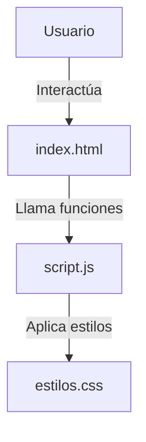

# Práctica de Trabajo Colaborativo (Tienda Tecsup)


Repositorio para el aprendizaje de flujos de trabajo colaborativo (Forks, Issues, Pull Requests) en Git y GitHub, utilizando como base una tienda web.

## Tabla de Contenidos

- [Instalación](#instalación)
- [Uso](#uso)
- [Características](#características)
- [Hoja de Ruta](#hoja-de-ruta)
- [Arquitectura](#arquitectura)
- [Contribución](#contribución)
- [Licencia](#licencia)
- [Autor](#autor)

## Instalación

Clona el repositorio en tu máquina local usando Bash:

```bash
git clone https://github.com/ErickLey/tienda-tecsup.git
cd tienda-tecsup
```

## Uso

Abre el archivo index.html en tu navegador. El cálculo del carrito procesa los ítems de esta manera:

```javascript
function calcularTotal(lista) {
    let total = 0;
    for (const producto of lista) {
        total = total + producto.precio * producto.cantidad;
    }
    return total;
}
```

## Características

| Función | Estado | Descripción |
| :--- | :---: | :--- |
| Cálculo del total | ✅ Activo | Multiplica precio por cantidad correctamente |
| Carga de CSS | ✅ Activo | Vinculación correcta de hoja de estilos |
| Carrito persistente | ❌ Pendiente | Guardado de ítems en localStorage |

## Hoja de Ruta

- [x] Corregir función del cálculo total en script.js
- [x] Corregir enlace de hojas de estilo en index.html
- [ ] Implementar vista previa de imágenes para productos

## Arquitectura



## Contribución

Lee la [guía de contribución](CONTRIBUTING.md) antes de enviar cambios.

1. Haz un fork del repositorio.
2. Crea una rama: git checkout -b mejora/mi-cambio
3. Guarda tus cambios: git commit -m "Describe tu cambio"
4. Sube la rama: git push origin mejora/mi-cambio
5. Abre un Pull Request explicando qué mejoraste.

## Licencia

Este proyecto usa la licencia MIT. Revisa el archivo [LICENSE](LICENSE).

## Autor

Hecho por **Erick Ley** - [GitHub](https://github.com/ErickLey)