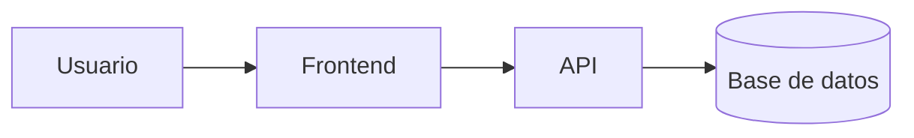
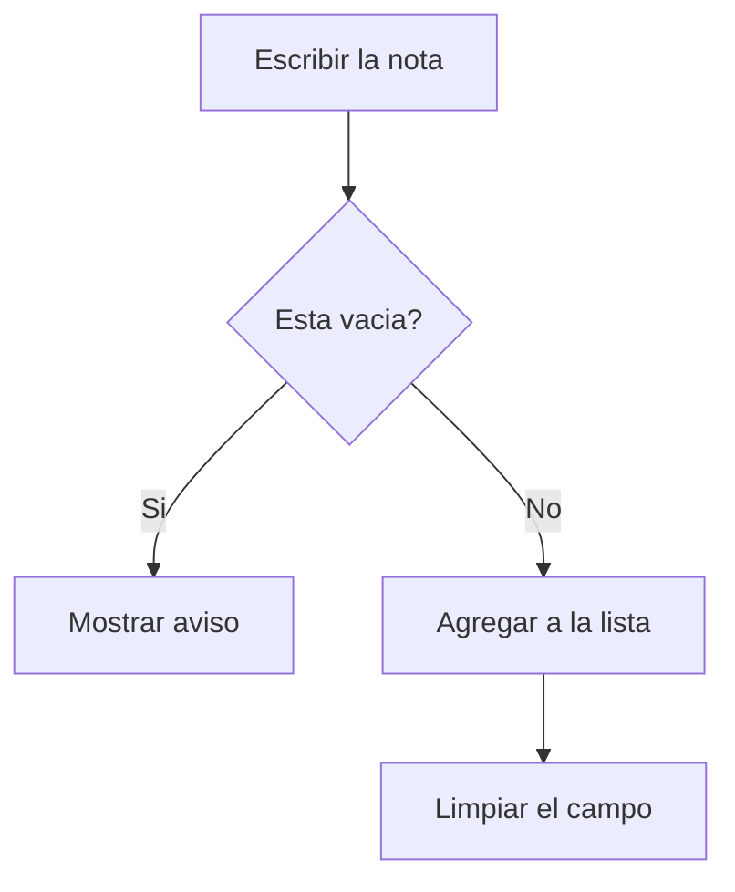

# App Notas


Una aplicación web sencilla para crear, guardar y gestionar notas directamente en tu navegador usando LocalStorage.

## Tabla de contenidos
- [Instalacion](#instalacion)
- [Uso](#uso)
- [Estado de las funciones](#estado-de-las-funciones)
- [Hoja de ruta](#hoja-de-ruta)
- [Ejemplos de codigo](#ejemplos-de-codigo)
- [Arquitectura](#arquitectura)
- [Contribucion](#contribucion)
- [Licencia](#licencia)

## Instalacion
No requiere instalación de dependencias. Solo necesitas un navegador web moderno.

## Uso
Abre el archivo `index.html` en tu navegador, escribe una nota en el campo de texto y presiona "Agregar".


## Instalacion
No requiere instalación de dependencias. Solo necesitas un navegador web moderno.

## Uso
Abre el archivo `index.html` en tu navegador, escribe una nota en el campo de texto y presiona "Agregar".
## Estado de las funciones 
  
| Funcion | Estado | Prioridad | 
|:--------|:------:|----------:| 
| Agregar nota | Listo | Alta | 
| Eliminar nota | En curso | Media | 
| Guardar en el navegador | Pendiente | Baja | 
  
## Hoja de ruta

- [x] Diseno de la pantalla
- [x] Agregar notas a la lista
- [ ] Eliminar notas
- [ ] Guardar con localStorage

## Ejemplos de codigo 
  
Estructura del formulario: 
  
```html 
<input id="nota" placeholder="Escribe una nota"> 
<button onclick="agregar()">Agregar</button> 
``` 
  
Funcion que agrega la nota: 
  
```js 
function agregar() { 
  const texto = document.getElementById("nota").value; 
   console.log("Nota agregada:", texto); 
} 
``` 
  
Ejemplo de nota guardada: 
  
```json 
{ "id": 1, "texto": "Estudiar Markdown", "hecha": false } 
``` 
## Arquitectura



### Flujo para agregar una nota


## Contribucion

1. Haz un fork del repositorio.
2. Crea una rama: `git checkout -b mejora/mi-cambio`
3. Guarda tus cambios: `git commit -m "Describe tu cambio"`
4. Sube la rama: `git push origin mejora/mi-cambio`
5. Abre un Pull Request explicando que mejoraste.

## Licencia

Este proyecto usa la licencia MIT. Revisa el archivo [LICENSE](LICENSE).

## Autor

Hecho por **Erick Ley** - [GitHub](https://github.com/ErickLey)
